# SOHO Network Lab

A segmented, secured small office network designed, built and tested in Cisco Packet Tracer. It covers VLANs, inter VLAN routing, DHCP, NAT, guest isolation, wireless access points and device hardening.

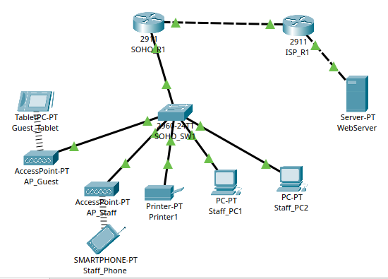

## Scenario

A five person consulting office works from a converted garage. It needs a staff network, a separate guest Wi-Fi that cannot reach office devices, a shared printer, and one shared internet connection. This scenario is fictional and was written for this project.

## Design goals

1. Separate staff, guest, device and management traffic on one switch.
2. Let staff and guests reach the internet through one public address.
3. Keep guests away from staff computers, the printer and the network equipment.
4. Allow remote management only from trusted networks, and only over SSH.
5. Close every unused switch port.

## Addressing plan

| Network | VLAN | Subnet | Gateway | Purpose |
| --- | --- | --- | --- | --- |
| Staff | 10 | 192.168.10.0/24 | 192.168.10.1 | Staff PCs and staff Wi-Fi |
| Guest | 20 | 192.168.20.0/24 | 192.168.20.1 | Guest Wi-Fi only |
| Devices | 30 | 192.168.30.0/24 | 192.168.30.1 | Shared printer |
| Management | 99 | 192.168.99.0/24 | 192.168.99.1 | Switch management |
| WAN link | none | 203.0.113.0/30 | 203.0.113.1 | Office router to ISP router |
| ISP web server | none | 198.51.100.0/24 | 198.51.100.1 | Simulated internet |

The first 20 addresses in each user network are excluded from DHCP and kept for fixed devices. The printer uses the fixed address 192.168.30.10.

## Devices

1. `SOHO_R1` : office router, runs the VLAN gateways, DHCP, NAT and the guest access list
2. `SOHO_SW1` : office switch, carries all VLANs over one trunk to the router
3. `ISP_R1` : simulated internet provider router
4. `AP_Staff` and `AP_Guest` : two access points, one per wireless network
5. Staff PCs, printer, staff phone, guest tablet and a web server on the simulated internet

## What was implemented

1. Four VLANs on the switch, with a trunk to the router using VLAN 99 as the native VLAN
2. Router on a stick inter VLAN routing with one subinterface per VLAN
3. A DHCP pool for each user network
4. NAT overload so staff and guests share one public address
5. An extended access list that blocks the guest network from Staff, Devices and Management, while allowing internet access
6. Two WPA2 wireless networks, one per access point, each placing devices in its own VLAN
7. Hardening on the router and switch: encrypted secrets, local user accounts, SSH version 2 only, a remote access list, login banner and idle timeout
8. Unused switch ports shut down and moved to an empty VLAN
9. Port security on the staff PC ports

## Key design decisions

| Decision | Reason |
| --- | --- |
| Separate guest VLAN with its own access point | Guests get internet only and cannot reach office devices |
| Access list placed inbound on the guest subinterface | Blocked traffic is dropped at the first router interface it reaches |
| Devices network left out of NAT | A printer does not need the internet |
| Dedicated management VLAN | Network equipment is administered away from user traffic |
| SSH only, limited to Staff and Management | Guests and the internet cannot attempt a login |
| Unused ports shut down in VLAN 999 | Nobody can plug into a spare wall port and join the network |

## Evidence

Every claim below is backed by a screenshot. The full device configurations are in the `configs` folder.

**Switch VLANs and trunk**

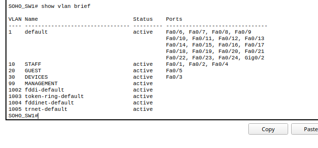

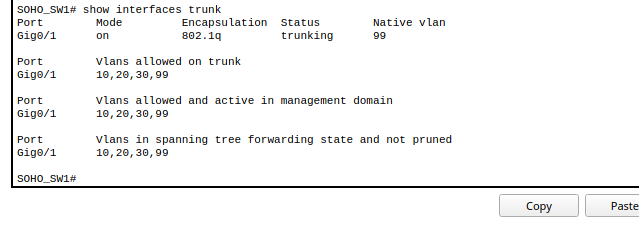

**Router interfaces and addressing**

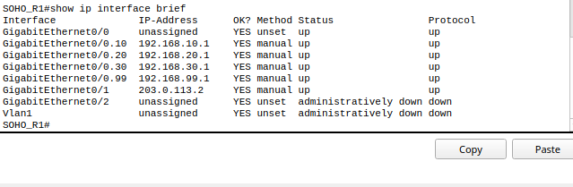

**DHCP and wireless clients**

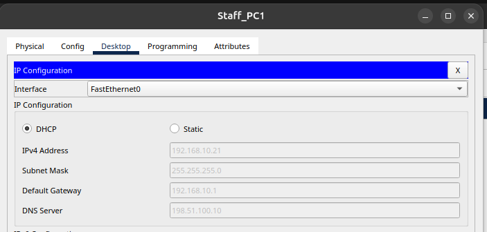

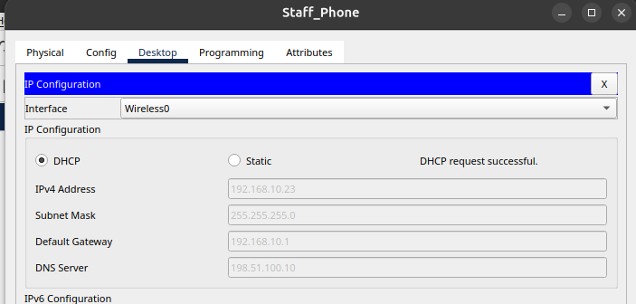

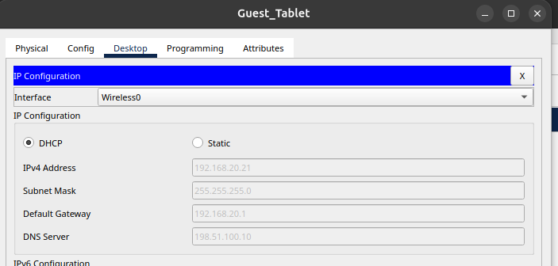

**Internet access and NAT**

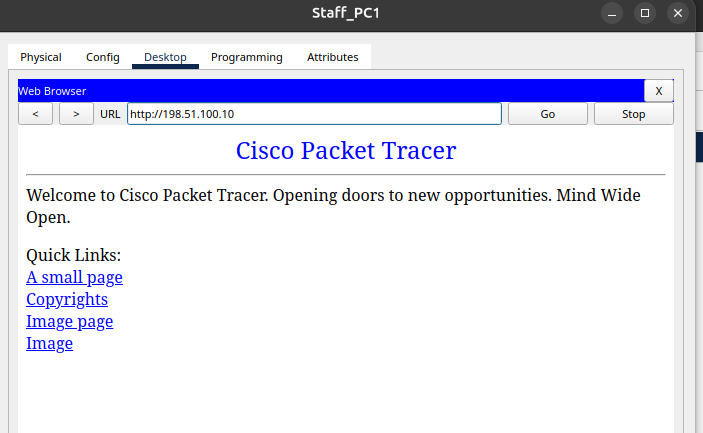

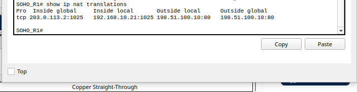

**Guest isolation**

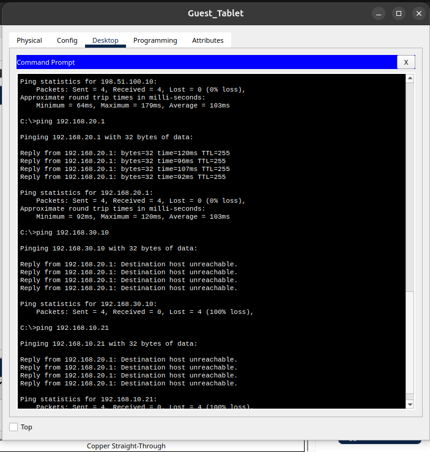

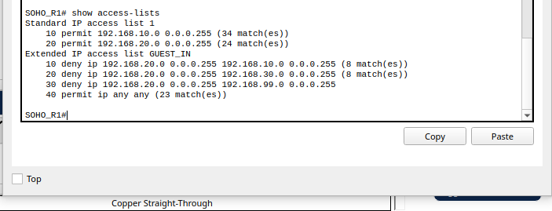

**Device hardening**

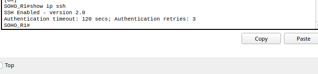

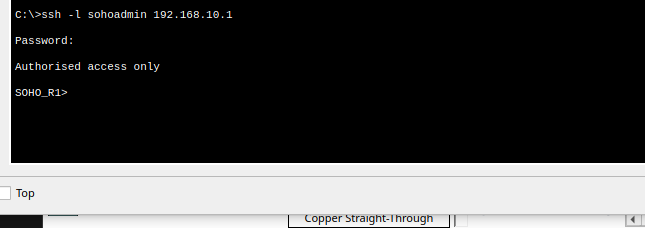

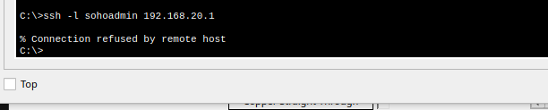

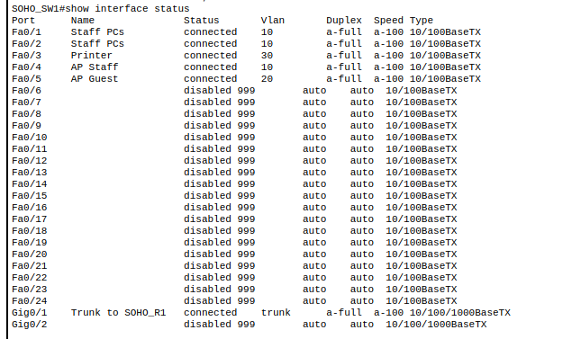

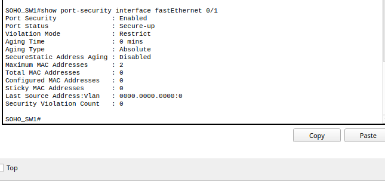

## Repository structure

1. `configs/` : exported running configurations for the office router, switch and ISP router
2. `packettracer/` : the completed lab file, `SOHONetwork.pkt`
3. `screenshots/` : the topology diagram and test evidence
4. `docs/` : design document, build guide, test plan and security notes

## Skills demonstrated

1. VLAN design and trunking
2. Inter VLAN routing and DHCP
3. NAT and access control lists
4. Wireless network separation
5. Network device hardening and SSH
6. Layer 2 security with port security
7. Testing, evidence collection and technical documentation

## Possible extensions

1. Add a second switch and a link between them with EtherChannel
2. Add DHCP snooping and dynamic ARP inspection
3. Add a syslog server for logging
4. Replace the single router with a router and firewall pair
5. Add an IPv6 addressing plan

## Note on credentials

The passwords used in this lab are simulation only values. The exported configuration files contain only scrambled copies of them. Never reuse lab credentials on a real network.

## Credits

Built in Cisco Packet Tracer, which belongs to Cisco. The network design, addressing plan, configurations and documents were produced for this project. I designed it with guidance from an AI assistant, and I built, configured and tested every part myself in Packet Tracer.

## Author

Hlumelo.

## Licence

Released under the MIT Licence. See `LICENSE`.
